  
  
  


#### 🤖 AI & LLM Applications

  <a href="https://github.com/betulaltunyuva/ai-research-assistant">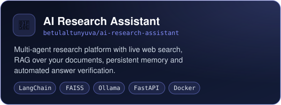</a>
  <a href="https://github.com/betulaltunyuva/learnlens-ai">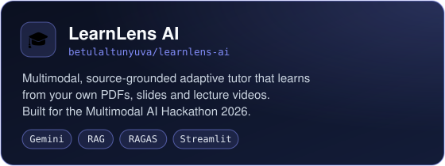</a>

#### 🛡️ Networks & Security

  <a href="https://github.com/betulaltunyuva/netwatch">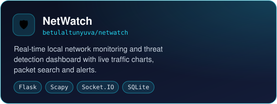</a>
  <a href="https://github.com/betulaltunyuva/smart-sdn-gns3">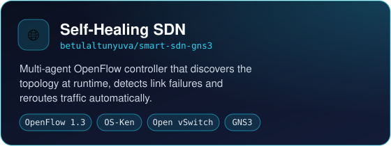</a>

#### 📱 Mobile Apps

  <a href="https://github.com/betulaltunyuva/ai-bibite">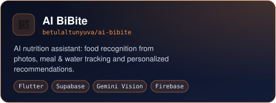</a>
  <a href="https://github.com/betulaltunyuva/pati-map">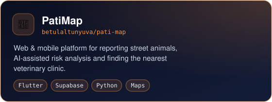</a>

#### 🧠 Machine Learning & Computer Vision

  <a href="https://github.com/betulaltunyuva/yolov8-person-counting">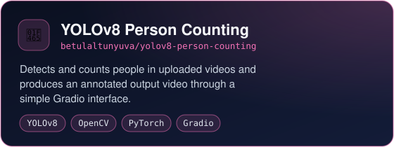</a>
  <a href="https://github.com/betulaltunyuva/som-customer-segmentation">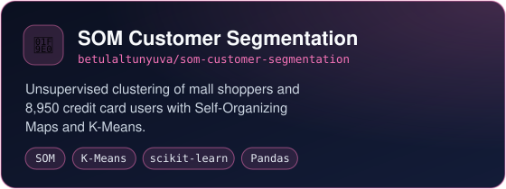</a>
  <a href="https://github.com/betulaltunyuva/breast-cancer-decision-tree-classification">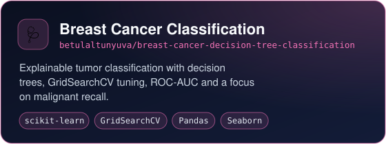</a>
  <a href="https://github.com/betulaltunyuva/wine-classification-project">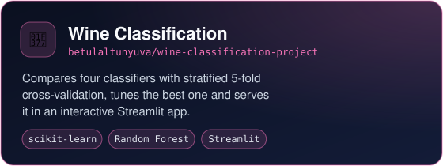</a>

#### 💻 Web & Algorithms

  <a href="https://github.com/betulaltunyuva/react-typescript-web-lab">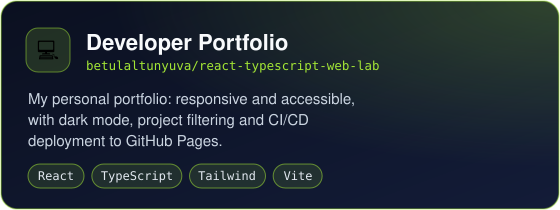</a>
  <a href="https://github.com/betulaltunyuva/collatz-random-number-generator">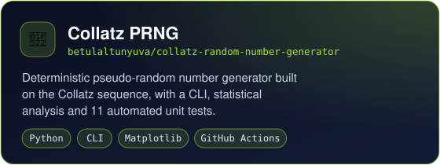</a>

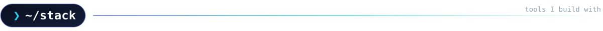

  

  
  
  
  
  
  
  
  
  

  
  

